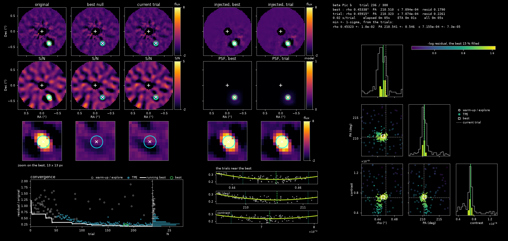

# A known companion's position and contrast: `klip-tpe extract`

`klip-tpe extract` fits a known companion in a finished run.  It gives the companion's separation,
angle and contrast with two sets of 1-sigma uncertainties, the bias and spread of the fit from fake
sources, and for data in wavelength groups, such as ALES's, the contrast per group with the position
held.  It ports the IDL predecessor's `subtract_mwc758c_tpe.pro` and `subtract_profile_scan.pro`,
which fitted MWC 758c on JWST/NIRCam data the same way.

The code is `klip_tpe/extract.py`.

## Running it

On a run made with the command line:

```
klip-tpe extract --run-dir RUN --rho 0.452 --pa 211.2 --contrast 7e-4 --label b
```

The data options come from the run's record, as `klip-tpe elect` takes them, and the run is only
read.  The output goes to `RUN_extract_b` beside the run (`--out` to choose), with its log in
`extract.log` and its live display in `steps/` (below).

On a run made by a script, resume the runner with the script's reducer and call the step:

```python
from klip_tpe.extract import ExtractConfig, extract_companion, write_extract
from klip_tpe.runner import Runner

runner = Runner.resume(run_dir, reducer, objective, sampler)    # as the script built them
found = extract_companion(runner, 0.452, 211.2, 7e-4, config=ExtractConfig(seed=1))
write_extract(found, run_dir + "_extract_b", label="b")
```

## What it does

1. **The configuration.**  The elected winner of the annulus that holds `--rho` reduces
   (`--annulus N` for another annulus, `--config EVAL` for another evaluation, numbered as the run's
   log numbers it).
2. **The residual.**  Each trial puts the companion's negative into every frame and reduces.  The
   reduced image is read in a fixed disk of `--patch` FWHM (default 2) around the starting position.
   The disk's pixels, less their mean, give an L2 norm, divided by the same norm of the reduction
   without the injection.  0 is a perfect null and 1 is no cancellation.  The residual is
   deterministic, so no trial is drawn again.
3. **The search.**  A TPE proposes `(rho, pa, contrast)` in a box around the start and maximizes
   `-log(residual)`, `--n-init` random trials first and `--n-iter` in all.  The box is 0.5 FWHM either
   side in separation, 0.5 FWHM along the arc in angle and 0.5 to 2 times the starting contrast
   (`--box-rho`, `--box-pa`, `--box-contrast`).
4. **Uncertainty 1, the quadratic.**  A full quadratic in the three parameters, each scaled by its box
   width, is fitted to the best 40 % of the trials (`--best-frac`).  With `H` its Hessian and the floor
   the rms of the fit's residuals, a parameter's sigma is `sqrt(2 floor (H^-1)_ii)` times its width.
   That is where the residual has risen by the floor.
5. **Uncertainty 2, the profiles.**  Two parameters are held at the best and the third is stepped over
   `4 nref + 1` points (21 for `--nref 5`) across 4 times its first sigma, at most half the box.  A
   parabola per parameter gives its sigma at the same rise and its own minimum.
6. **The recovery check.**  `--fakes` sources (default 5) at the fitted separation and contrast, at
   angles spread evenly from the companion's, go into the data with the companion taken out at its
   fit.  Each is fitted like the companion, from a start as far off as the companion's was, with
   `--fake-iter` trials and no profiles.  Their mean offsets are the bias with its standard error,
   and their standard deviation is the spread of a fit.
7. **Wavelength groups.**  With several partitions the position comes from all of them combined.
   Each partition's contrast is then fitted alone with the position held.  A coarse scan of 11 points
   from 0.2 to 2.2 times the combined contrast, moved once when its minimum falls on an edge, brackets
   the minimum.  A bounded Brent search between the lowest point's two neighbors refines it to 0.2 %,
   and a profile of `4 nref + 1` points around it gives the parabola.  The profile is as wide,
   relative to the contrast, as the combined fit's contrast profile, so the two sigmas read alike
   (below).  With fakes, each partition also gets its own recovery check: fake sources at its fitted
   contrast, at the same angles as above, with the companion taken out at that contrast, each fitted
   the same way with its position held, from a start as far off as the partition's own.  The contrasts
   with their sigmas are the spectrum.  `--no-groups` skips them.

## The groups' own positions

`--group-positions` (`ExtractConfig.group_positions`) adds a fit of each group's own position and
contrast, alongside the combined fit, which stays as it is.  Each group gets a TPE search of
`--group-iter` trials (300) in a box half as wide as the combined fit's (`--group-box`), centered on
the combined position, with its contrast from its own fit with the position held.  Its profile
scans give the sigmas, and with fakes its own recovery check gives their scatter.  The summary
then has:

- each group's dx and dy from the star, rho, pa and contrast, each with its sigma to quote
  (`extract_partition_positions.txt`),
- the weighted mean of the groups' dx and dy, and its offset from the combined fit in pixels and in
  sigma,
- a chromatic test: the weighted slope of dx and of dy against wavelength with its significance,
  and the chi2 of a constant with its probability,
- `extract_positions.pdf`, dx and dy against wavelength with the combined fit and the fitted line.

It is a check of the registration across wavelength, and of the astrometry before it goes out.
Each group adds about `group_iter + 64` reductions of that group alone, and with fakes
`n_fakes (1 + group_iter)` more.

## The live display

The step draws a live dashboard of the fit into `steps/` in its output directory, after the IDL
predecessor's `mwcm_sub_dash`.  Watch it from another terminal with

```
klip-tpe view --run-dir RUN_extract_b
```

The run's panel process draws the panels, so the fit never waits for one, and a panel asked for while
the last is still being drawn is skipped.  The last panel of each stage, and those of the partitions
and the fake sources, are always drawn.  At the end the panels make `extract_steps.gif`.



Each panel is 1600 x 760 pixels on black, laid out as the IDL predecessor drew it:

- **The images**, centered on the star in inferno.  The upper row holds the original, the best null, the
  current trial and the injected models of the best and of the trial (the original less each null), on
  the original's scale.  The lower row holds their S/N maps (a matched filter with the small-sample
  correction, from -2 to 5) and the PSF models of the best and of the trial, from the run's injection
  model.  The star is a +, and the best an x on every panel.  A cyan circle marks the trial on its
  panels and the best on the others, and a green circle the reference position (`--reference RHO PA`,
  such as a published position).
- **The zoom stamps**, 13 x 13 pixels on the best, under the upper row and on its scale.
- **The convergence trace**, the residual of every trial, with the random draws as gray open circles,
  the TPE's proposals filled, the running best as a line, the best as a green circle and a sideways
  histogram.
- **The parabolas**, the residual against each parameter for the best 40 % of the trials, with the
  parabola, its minimum and 1-sigma.  Once the profile scans run, they take the trials' place.
- **The corner plot** of the trials in rho, PA and contrast, colored by -log residual.
- **The text**, with the trial count, the best and the trial's values, the time per trial, the elapsed
  time, the ETA and the live minimum with its 1-sigma.

The later stages have panels of their own:

- each fake source's fit, on its own reduction, with its true position as a dashed magenta circle and a
  running table of the fakes' offsets,
- with partitions, a spectrum that fills as each partition's contrast is fitted, its error bars widened
  to the partition's fakes' scatter as they come,
- with `--group-positions`, each partition's own fit, on that partition's reduction, and a chromatic
  panel of the partitions' dx and dy less the combined fit against wavelength.

They take the corner plot's place, which keeps as many of its pairs as there is room for.

`--display-every N` asks for a panel every N trials (default 1), and `--no-display` draws none.  The
display adds no reductions.  A panel takes about half a second to draw on an idle core, and longer
beside a busy fit, so a fast fit gets one every few trials.  The `--quick` check on beta Pic b, about
960 reductions of 0.02 s each, drew 47 panels.

From a script, give `extract_companion` (or `fit_companion`) the display as its `progress`:

```python
from klip_tpe.extract_display import ExtractDisplay

disp = ExtractDisplay(out_dir, label="b", reference=(0.452, 211.2))
found = extract_companion(runner, 0.452, 211.2, 7e-4, progress=disp)
write_extract(found, out_dir, label="b")
disp.close()                     # waits for the panels and makes the movie
```

### Afterwards, from the saved tables

`klip-tpe extract --render DIR` draws the dashboard of a finished extraction without a new fit, a panel
every 10 trials unless `--display-every` says otherwise.  The trials, the profile scans, the partitions,
their own positions and the fakes come from the extraction's tables and summary, and the images from
`extract_clean.fits` and `extract_residual.fits`.  The live display saves each trial's cut-out in
`extract_trial_crops.npz`, which the render takes.  An extraction made without it has no trial images,
so each trial's panels show the best's injected model moved to the trial and scaled to its contrast,
titled as an approximation.  The fakes' and the partitions' own fits come as their tables, since their
trials were not saved.  The panels go to `steps/`, or to `steps_saved/` beside a live display's.

## Which sigma to quote

The quadratic and the profiles measure how sharply the residual rises around its minimum.  They do
not measure the speckle noise in the patch, which moves the minimum itself, and they shrink as the
trials crowd the minimum.  The fake sources measure that spread directly.  On beta Pic b
(`scripts/check_betapic_extract.py`, the defaults):

| | rho | pa | contrast |
|---|---|---|---|
| fit | 0.4516" | 210.64 deg | 7.17e-4 (dL' 7.86) |
| #1 quadratic | 0.0007" | 0.046 deg | 0.9 % |
| #2 profiles | 0.0002" | 0.013 deg | 0.2 % |
| 5 fakes: scatter | 0.0023" | 0.15 deg | 4.3 % |
| 5 fakes: bias | -0.0001 +- 0.0010" | -0.13 +- 0.07 deg | +3.0 +- 1.9 % |
| Absil et al. 2013, these data | 0.452 +- 0.010" | 211.2 +- 1.3 deg | dL' 8.01 +- 0.16 |

The fit lies within 1 sigma of the published values in all three, and the fakes' scatter is 3 to 20
times either estimator.  The summary's `to quote` line therefore gives the larger of the profile sigma
and the fakes' scatter, per parameter, and each partition's contrast carries the larger of its
profile sigma and its own fakes' scatter.  With 5 fakes the scatter is itself uncertain by about a
third.  More fakes, or a second check with another seed, firm it up.

The profile sigma also depends on how wide the profile is.  The residual is a smooth, deterministic
function of each parameter, parabolic only near its minimum, so the parabola's floor, the rms of its
residuals, grows with the profile's width, and the sigma with it, about as the width squared.  A
partition's profile used to span 4 times a first sigma read off its coarse scan, up to the scan's own
width.  That read the scan's steps, not the data, and gave sigmas several times the partition's fakes'
scatter.  It now takes the combined fit's relative width.

### The fakes' bias

The fakes' mean offsets are the bias, with a standard error from their scatter.  The summary prints
the best less the bias (`best less bias`) and each bias over its standard error.  Where that exceeds
the two-sided 95 % point of Student's t with `n_fakes - 1` degrees of freedom (2.78 for 5 fakes), the
bias is significant.  The `to quote` value is then the best less the bias, and its sigma has the bias'
standard error added in quadrature.  Each partition's contrast follows the same rule with its own
fakes.  The fakes sit at the companion's separation and contrast, so a bias the configuration puts on
every source there comes off the companion as it does off them.

## Which configuration

The annulus' elected winner reduces unless another is named.  A negative injection cancels the
companion in every frame before the PSF subtraction, so at the null no reference frame, ADI's
included, holds any of it, and the residual's minimum lies at the companion in any configuration.
Away from the null, an ADI basis holds part of the mismatch and subtracts it, which flattens the
residual around the minimum.  The sigmas then come out wider, as they should, and the recovery check
measures the bias that remains in the configuration used.  The IDL predecessor fitted MWC 758c in
its production ARDI configuration the same way.

A configuration whose references never hold the companion (RDI) gives a sharper minimum, but not
always a lower floor.  Name it with `--config` to compare.

An angle offset between the injection and the derotation cannot bias the fakes.  Each fake and each
trial's negative go into the frames through the same injection, with the frames' angles and the same
true north, so an offset turns them together and their null, the residual's minimum, stays where the
fake was put.  In a synthetic sequence of 100 frames over 78 degrees, an RDI configuration with the
injection turned 0.5 degrees from the derotation brought its six fakes back +0.012 +- 0.027 degrees
from where they were put.  For the same reason the companion's fitted angle is in the injection's
frame.  A wrong north or a wrong sign in the frames' angles would move it, and no fake can show that.

A bias in angle that every fake shares therefore comes from the reduction or the fit, not from the
angles' bookkeeping.  ADI's self-subtraction is one candidate.  When the field turns faster near
transit it is uneven in time, so a source's subtracted lobes are not symmetric along the arc.  The
run's RDI configuration (`--config`) shows whether a bias goes with the ADI references.  The fakes sit
at the companion's separation and contrast in the same configuration, so they measure such a bias for
the companion too, and the summary takes it off where it is significant.

## What it writes

| File | What it holds |
|---|---|
| `extract_summary.txt`, `extract_summary.json` | The best values, the position in pixels from the star, both sets of sigmas in arcsec, degrees, pixels and percent, the profiles' minima, the floors, the reductions, the recovery check with the best less its bias and the bias' t, the values and sigmas to quote, the partitions' contrasts and the `--subtract-sources` line |
| `extract_trials.txt` | Every search trial: rho, pa, contrast, residual and how it was proposed |
| `extract_profiles.txt` | The profile scans' points |
| `extract_partitions.txt` | Each partition's wavelength, contrast, the sigma to quote, the profile sigma, its fakes' bias and scatter, the floor, and the contrast less the bias and the contrast to quote |
| `extract_partition_positions.txt` | With `--group-positions`, each group's dx, dy, rho, pa and contrast with the sigmas to quote |
| `extract_fakes.txt` | Each fake source's true and fitted values |
| `extract_subtract_sources.txt` | The fitted companion, for `--subtract-sources` in later runs |
| `extract_clean.fits`, `extract_residual.fits` | The reduction without the injection and the best fit's |
| `extract_fit.pdf` | The residual against each parameter, the best trials with their parabolas and the quadratic's sigmas above, the profiles with theirs below |
| `extract_images.png` | Both reductions around the companion, with the patch |
| `extract_spectrum.pdf` | Each partition's contrast to quote with its sigma, and the fit where a significant bias was taken off |
| `extract_positions.pdf` | With `--group-positions`, each group's dx and dy against wavelength, the combined fit and the weighted line |
| `steps/stepNNNN.png`, `extract_steps.gif` | The live display's panels and its progress movie (`extract_steps.mp4` too where imageio has ffmpeg) |
| `extract_trial_crops.npz` | With the live display, each search trial's image around the star, for `--render` |
| `extract.log` | The step's log |

## Cost

A fit takes `1 + n_iter + 3 (4 nref + 1)` reductions, 1064 with the defaults.  Each partition adds
about 40 reductions of that partition alone, and about 35 per fake source for its recovery check.  Each fake source of the combined fit adds `1 + fake_iter` reductions.  These are the larger
part with the defaults, 5005 reductions, so `--fake-iter 300` or `--fakes 3` makes a quicker first
pass.  On beta Pic b's 61 NACO frames the defaults took 4 minutes on 2 cores.

## Notes

- Separations are in arcsec at the run's plate scale, and angles in degrees East of North in the
  image frame.  The step does not calibrate the plate scale or north, which stay with the reduction.
  Contrasts are in the injection model's flux unit.
- During the step the run's injection spectrum is flat, so a fake source and the negative injection
  go into every partition at the contrast given.  The combined fit's contrast is then a weighted
  mean over the partitions, and the partitions' own fits give the spectrum.
- A source of `RunConfig.subtract_known` within 2 FWHM of the start is left out of the reductions,
  since the step fits it, and the summary lists it.  A run whose frames had a source near the start
  taken out by `--subtract-sources` is refused, since there is nothing left to fit.  Give
  `--subtract-sources` a list without it.
- The IDL predecessor searched a box of 0.04" and 5 degrees either side and 0.5 to 2 times the
  contrast on MWC 758c, and read a 12-pixel square on it, about 2.7 FWHM either side of the
  companion.  `--box-rho 0.04 --box-pa 5` sets that box.  The other defaults are its own: 100
  random trials of 1000, gamma 0.15, 24 candidates, 15 % random draws, the best 40 % for the
  quadratic and 21 points per profile.
- `klip_tpe.companion.fit_negative_companion` is the quicker fit without uncertainties, a contrast
  grid and a Nelder-Mead.
